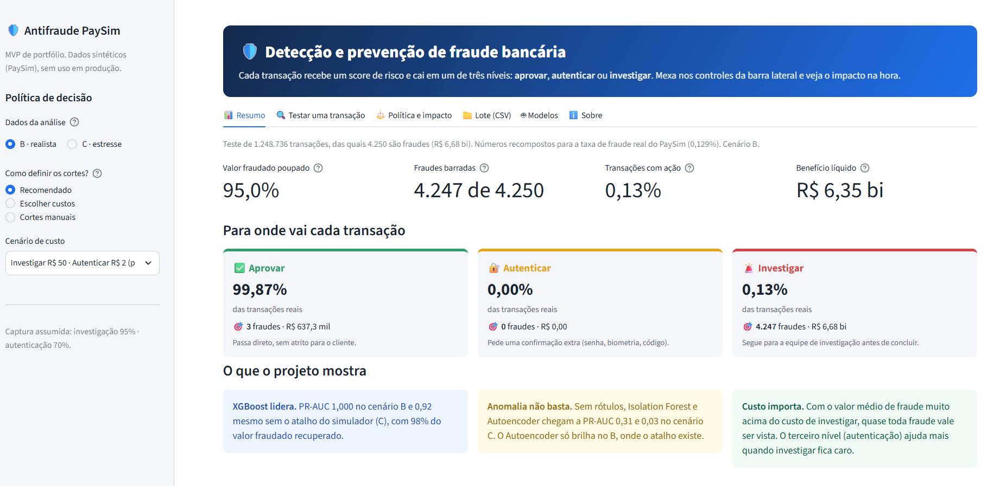
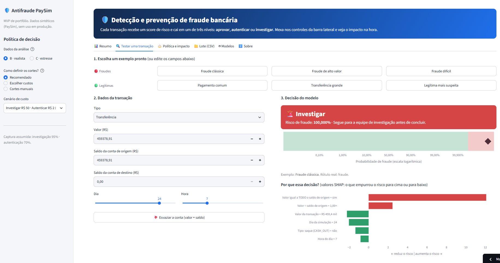
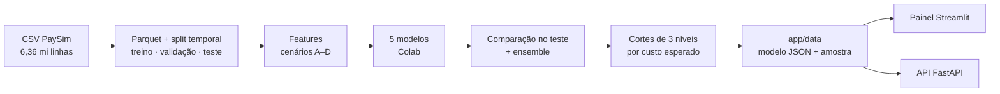

# 🛡️ Detecção e prevenção de fraude bancária (PaySim)

Sistema de monitoramento de transações que **atribui um score de risco** a cada operação e decide entre
**aprovar**, **pedir autenticação adicional** ou **investigar**, com cortes escolhidos pelo **menor custo esperado**.

**[▶ Abrir o painel interativo](https://antifraude-paysim.streamlit.app)** ·
[Relatório técnico](docs/relatorio_tecnico.md) ·
[Registro de decisões](docs/decisoes.md)



> Projeto de portfólio com dados sintéticos (PaySim), sem uso em produção.
> O app gratuito "dorme" quando fica parado; ao abrir o link, pode levar cerca de 1 minuto para acordar.

---

## Em poucas linhas

- **6,36 milhões de transações**, **0,129% de fraude**, avaliadas com **split temporal** (o modelo prevê o futuro, nunca o passado).
- **5 modelos comparados**: Regressão Logística, Random Forest e XGBoost (supervisionados); Isolation Forest e Autoencoder (anomalia).
- **XGBoost venceu**: no teste, barrou **4.247 de 4.250 fraudes** com **zero falso positivo** no cenário realista
  e manteve **PR-AUC 0,92** mesmo sem o principal atalho do simulador.
- **Decisão em três níveis por custo**: os cortes minimizam (custo de autenticar/investigar) + (perda das fraudes que passam).
  Poupa **95% do valor fraudado** (o teto da premissa de captura).
- **Explicável**: cada decisão mostra os fatores que mais pesaram (valores SHAP do XGBoost).
- **Honesto sobre limites**: testes de estresse mostram onde o modelo depende de artefatos do simulador,
  e uma regra de precaução cobre entradas fora da faixa conhecida.

## Resultados (conjunto de teste, 1,25 mi de transações, 4.250 fraudes)

| Modelo | PR-AUC · cenário B (realista) | PR-AUC · cenário C (estresse) | Recall em valor · C |
|---|---|---|---|
| **XGBoost** | **1,000** | **0,920** | **98,2%** |
| Random Forest | 1,000 | 0,817 | 97,0% |
| Regressão Logística | 0,9998 | 0,468 | 88,6% |
| Isolation Forest | 0,220 | 0,306 | 50,3% |
| Autoencoder | 0,978 | 0,026 | 8,8% |

- **Cenário B** usa só o que o banco sabe **antes** de aprovar (tipo, valor, hora, saldos anteriores).
- **Cenário C** remove os sinais de "esvaziar a conta", que no PaySim entregam a fraude quase de graça.
  É ele que mostra quem realmente generaliza.
- **Ensemble** (stacking e média ponderada) **não superou o XGBoost sozinho**, e os modelos de anomalia receberam peso zero.

**Decisão em três níveis (cenário C, custos padrão R$ 50 investigação / R$ 2 autenticação):**
97,2% das transações aprovadas direto · 1,9% autenticadas · 0,9% investigadas · 9 fraudes escapam de 4.250.
Os cortes, escolhidos na validação, perdem no máximo **0,02%** do benefício em relação ao melhor corte possível no teste.

## O painel



| Aba | O que mostra |
|---|---|
| 📊 **Resumo** | Valor poupado, fraudes barradas, carga operacional e para onde vai cada transação |
| 🔍 **Testar uma transação** | Botões de exemplos prontos (fraudes e legítimas), formulário, medidor de risco e explicação SHAP |
| ⚖️ **Política e impacto** | Cortes e custos ajustáveis, separação entre fraudes e legítimas, ganho do terceiro nível |
| 📁 **Lote (CSV)** | Pontua um arquivo inteiro de transações (há um CSV de exemplo para baixar) |
| 🤖 **Modelos** | Comparação dos 5 modelos e do ensemble nos cenários B e C |
| ℹ️ **Sobre** | Metodologia e limitações |

Sugestão de roteiro: clique em **"Legítima mais suspeita"** e depois em **"💥 Esvaziar a conta"** para ver a decisão virar;
teste a **"Fraude difícil"** para ver um limite do modelo; mude a barra lateral para **"C · estresse"** para ver os três níveis.

## Arquitetura



O mesmo código (`src/fraud`) é usado no treino, no painel e na API, então as features são calculadas igual nos três.

## Estrutura do repositório

```
app/            painel Streamlit (streamlit_app.py) e seus dados (app/data, gerados pelo notebook 06)
api/            API FastAPI: /health, /score (com motivos) e /score/lote
src/fraud/      código reutilizável: dados, split, features, métricas, anomalia, custos, ensemble, cortes, scoring
notebooks/      00–06: setup, EDA, supervisionados, anomalia, avaliação final, cortes, exportação do painel
tests/          testes automatizados (pytest)
docs/           relatório técnico, registro de decisões e imagens
configs/        configuração central (caminhos, split, custos)
```

## Como rodar

**Painel (local):**
```bash
python -m venv .venv
.venv\Scripts\python -m pip install -r app\requirements.txt        # Linux/Mac: .venv/bin/python -m pip ...
.venv\Scripts\python -m streamlit run app\streamlit_app.py
```

**API:**
```bash
.venv\Scripts\python -m pip install fastapi uvicorn
.venv\Scripts\python -m uvicorn api.main:app --reload             # documentação em http://127.0.0.1:8000/docs
```

**Testes:** `pip install -r requirements.txt` e `pytest`.

**Treino do zero (Google Colab):** coloque o projeto no Google Drive e o CSV do PaySim
([Kaggle](https://www.kaggle.com/datasets/ealaxi/paysim1)) em `data/raw/`, e rode os notebooks na ordem 00 → 06.
O notebook 04, que retreina os 5 modelos com todos os dados, leva cerca de 17 minutos em CPU.

## Limitações

- **Dados sintéticos.** O PaySim tem atalhos que um banco real não teria (fraude sempre esvazia a conta, teto de R$ 10 mi por fraude).
- **Modelo do painel depende do atalho.** No cenário B, 85% da importância do XGBoost está em "valor = saldo inteiro";
  uma fraude que não esvazie a conta tende a passar (veja o exemplo "Fraude difícil").
- **Sem histórico do cliente.** O PaySim não traz o comportamento anterior de cada conta, o que mais ajudaria na vida real.
- **Custos e taxas de captura são premissas** (investigação R$ 50 / 95%, autenticação R$ 2 / 70%), não dados reais.

Detalhes, métricas completas e recomendações para uma implantação real estão no [relatório técnico](docs/relatorio_tecnico.md).

---

Feito por [@elieserribeiro](https://github.com/elieserribeiro).
